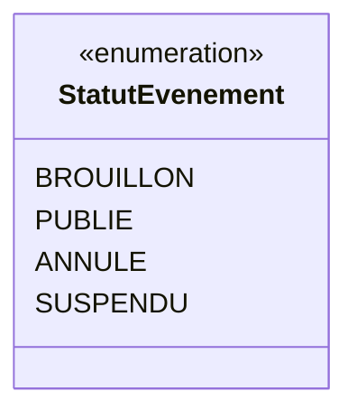

# Documentation UML Campus360

Les diagrammes de référence sont disponibles dans [le diagramme de classes](diagramme_classes.jpeg) et [le diagramme de cas d’utilisation](diagramme_cas_utilisation.jpeg).

## Extension D01 approuvée

La décision du porteur du projet du 17 novembre 2026 ajoute SUSPENDU à StatutEvenement. Cette extension complète l’énumération du diagramme de classes source.

| Action administrative | État de départ | État obtenu |
| --- | --- | --- |
| Valider | BROUILLON | PUBLIE |
| Suspendre temporairement | PUBLIE | SUSPENDU |
| Rétablir | SUSPENDU | PUBLIE |
| Retirer | État courant | ANNULE |

Les actions valider, suspendre et rétablir sont réservées à ADMINISTRATEUR. Une répétition qui vise l’état déjà obtenu est idempotente. La validation administrative d’un événement suspendu passe par l’action explicite de rétablissement. Les actions dédiées valider et rétablir renvoient un conflit pour un événement annulé.

Les organisateurs autorisés publient directement leurs événements. Pour un événement suspendu, ils peuvent modifier les informations et la capacité en conservant SUSPENDU. Le serveur protège toute entrée ou sortie de cet état.

Le catalogue public, les détails publics et les listes publiques d’événements des clubs sélectionnent PUBLIE. SUSPENDU bloque les nouvelles inscriptions et conserve les inscriptions existantes, leur statut et leur date. Les étudiants retrouvent ces inscriptions dans leur planning et peuvent les annuler suivant D07.

La disponibilité est calculée à partir de capaciteMax et des inscriptions CONFIRMEE. Un événement publié plein conserve PUBLIE et présente COMPLET. Le rétablissement recalcule les places disponibles, y compris après une annulation d’inscription pendant la suspension.

L’extension est matérialisée par la migration `V4__approved_event_suspension.sql`. Le [rapport fonctionnel mis à jour](../backlog/Rapport_Fonctionnel_MVP1_Campus360.pdf) contient la fiche d’approbation D01 en ouverture.
